```mermaid
flowchart LR
    A["Data Collection"] --> B["Data Cleaning"]
    B --> C["Exploratory Data Analysis"]
    C --> D["Data Visualization"]
    D --> E["Machine Learning"]
    E --> F["Insights & Results"]
    F --> G["Dashboard Development"]

    style A fill:#09001F,stroke:#00F5FF,color:#00F5FF
    style B fill:#09001F,stroke:#BF00FF,color:#BF5FFF
    style C fill:#09001F,stroke:#00F5FF,color:#00F5FF
    style D fill:#09001F,stroke:#BF00FF,color:#BF5FFF
    style E fill:#09001F,stroke:#00F5FF,color:#00F5FF
    style F fill:#09001F,stroke:#BF00FF,color:#BF5FFF
    style G fill:#09001F,stroke:#00F5FF,color:#00F5FF
```
 

  

---

<h2 align="center">

</h2>

**Hi, I'm Sevil Alizade!**

💜 Interested in Data Science and Data Analytics.

💙 Working with Python for data analysis and data science applications.

💜 Exploring data collection, web scraping, data cleaning and EDA.

💙 Studying Machine Learning and Deep Learning.

💜 Discovering patterns and extracting meaningful insights from data.

💙 Exploring data visualization and dashboard development.

💜 Always learning and improving my technical skills.

---

<h2 align="center">

</h2>

---

<h2 align="center">

</h2>

### 💻 Programming & Databases

### 📊 Data Analysis & Visualization

  

### 🤖 Machine Learning & Web Scraping

### 📈 Dashboard Development

---

<h2 align="center">

</h2>

| Subject | Topics |
|:---:|:---|
| 🐍 Python | Data analysis and programming |
| 🗄️ SQL | Database queries and data management |
| 📊 Data Analysis | Data cleaning, preprocessing and EDA |
| 🌐 Web Scraping | Data collection with BeautifulSoup |
| 📐 Mathematics | Mathematical foundations for Data Science |
| 🤖 Machine Learning | ML concepts and algorithms |
| 🧠 Deep Learning | Fundamentals of neural networks |

---

<h2 align="center">

</h2>

  

  

---

<h2 align="center">

</h2>

---

<h2 align="center">

</h2>

---

<h3>✨ LEARNING • EXPLORING • GROWING WITH DATA ✨</h3>

*Every dataset has a story. I'm learning how to discover it.*

