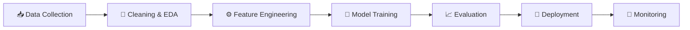

<!-- ============================================================
  DATA SCIENCE GITHUB PROFILE README (English)
  How to use:
  1. Create a new PUBLIC repo named exactly like your GitHub username (YOUR_USERNAME).
  2. Tick "Add a README file" and paste this file's content into it.
  3. Replace YOUR_USERNAME, Your Name, and the other placeholders with your own info.
============================================================ -->

 

---

## 👨‍💻 About Me

- 🔭 Currently working on **Machine Learning** and **Deep Learning** projects
- 🎓 Pursuing a degree in **Computer Science / Data Science**
- 📊 I analyze, visualize, and model data to support better decisions
- 🤖 Interested in **AI, NLP, Computer Vision, MLOps, and Automation**
- 🌱 Currently learning: **PyTorch, Transformers, LLMs, Data Engineering**
- 💬 Ask me about: **Python, Pandas, Scikit-learn, SQL, Data Visualization**
- ⚡ Fun fact: *"Data is the new oil, but it's useless until it's cleaned!"* 😄

  

---

## 🌐 Follow Me On

---

## 🧰 Languages & Tools I Have Placed My Hands On

---

## 📊 GitHub Stats

 

  

---

## 🛠️ Tech Stack

**Programming**

**Data Analysis & Visualization**

**Machine Learning / Deep Learning**

**Databases & Cloud**

**Tools**

---

## 🔬 My Data Science Workflow

---

## 🏆 Top Contributed Repos

 

---

## 📁 Featured Projects

| Project | Description | Tech |
|---------|-------------|------|
| 🏠 [House Price Prediction](https://github.com/YOUR_USERNAME/house-price-prediction) | Regression model to predict real-estate prices | `Python` `Scikit-learn` `Pandas` |
| 💬 [Sentiment Analysis](https://github.com/YOUR_USERNAME/sentiment-analysis) | NLP pipeline for classifying text sentiment | `Python` `Transformers` `PyTorch` |
| 🖼️ [Image Classifier](https://github.com/YOUR_USERNAME/image-classifier) | CNN-based image classification | `TensorFlow` `Keras` `OpenCV` |
| 📊 [Sales Dashboard](https://github.com/YOUR_USERNAME/sales-dashboard) | Interactive dashboard for sales KPIs | `Power BI` `SQL` |

---

## 💬 Random Dev Quote

  

---

## ✍️ Latest Blog Posts

<!-- BLOG-POST-LIST:START -->
<!-- Can be auto-updated from Medium/dev.to using a GitHub Action -->
<!-- BLOG-POST-LIST:END -->

---

## ☕ Support Me

⭐ If you like my projects, don't forget to leave a **star**!

